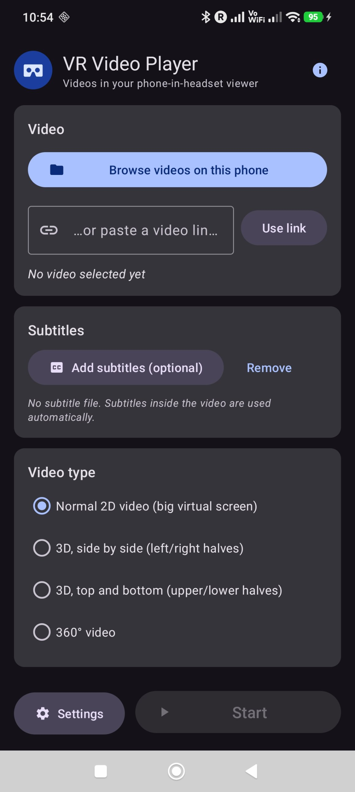
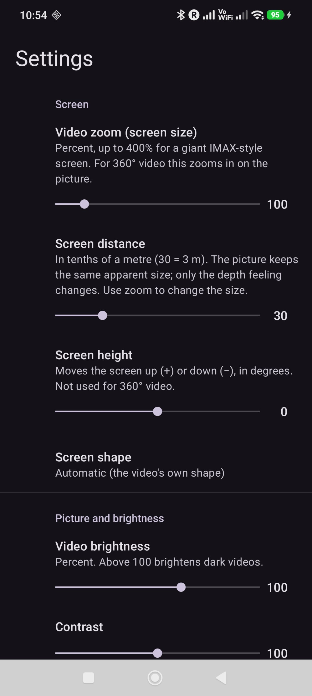
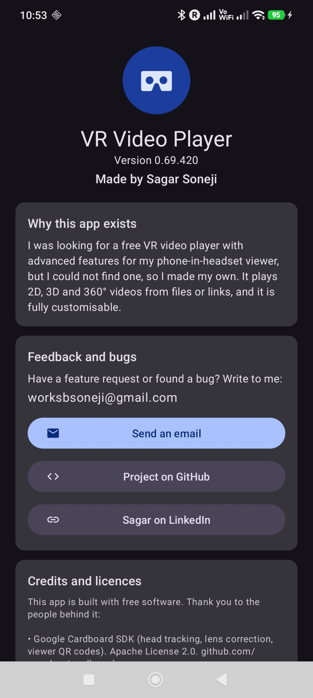

# VR Video Player

**A free, feature-rich VR video player for phone-in-headset (Cardboard-style) viewers.**
Play 2D, 3D and 360° videos from your phone or from a link, with controls you can use from
inside the headset, no buttons needed.

  
  
  

## Why this exists

I was looking for a free VR video player with advanced features for my phone-in-headset viewer,
but I could not find one, so I made my own. It is free, has no ads, and is fully customisable.

## Download

Get the latest APK from the **[Releases page](https://github.com/sbsoneji/VRVideoPlayer/releases/latest)**,
copy it to your Android phone and open it. Android will ask you to allow installing from this
source. Needs Android 8.0 or newer, with a gyroscope.

## Features

**Video**
- 2D video on a big virtual cinema screen
- 3D side-by-side and top-and-bottom (half or full, left/right eye swap)
- 360° video
- Play files from your phone or links (mp4, HLS `.m3u8`, DASH `.mpd`)
- Subtitles from the video or from a subtitle file (`.srt`, `.vtt`, `.ass`, `.ttml`)

**Control from inside the headset**
- A dot in the middle of your view: keep it on a button for 2 seconds to click it
  (the time can be changed, or turned off)
- Or click with a mouse; the pointer position is calibrated to your lenses
- Control bar with play/pause, seek bar, skip, volume, zoom, recenter, settings and exit; it
  appears when you look down, and you can move it lower
- Settings page inside the headset: zoom, distance, height, brightness, contrast, eye distance,
  speed, captions, subtitle and audio tracks

**Customisation**
- Video zoom from 50% up to **400%** (IMAX-style screen)
- Screen distance, height and shape (16:9, 4:3, 21:9, 1:1, stretch)
- Brightness, contrast, colour saturation; phone screen brightness
- Eye distance adjustment
- Playback speed, skip step, repeat, auto-start
- Caption size, colour, background and position
- Your viewer is remembered: scan its QR code once

## How to use

1. Open the app, **browse** for a video or paste a link.
2. Check the video type (it is guessed from the file name).
3. Press **Start**, put the phone in the headset, and look down to bring up the control bar.
4. Put the dot on **Play** for 2 seconds (or click with a mouse).

For the best picture, scan the QR code on your viewer once (**Headset > Scan a new viewer QR
code**). If your viewer has no QR code, the original Cardboard profile is used.

**A note on focus.** Focus (diopter) is set by the lenses in your viewer, so an app cannot
change it. If you wear glasses, check whether they fit inside your viewer, or use a viewer with
focus adjustment or clip-in lenses.

## Build it yourself

You need a recent Android Studio, a physical Android phone, and the SDK pieces listed in
the [developer guide](docs/DEVELOPER-GUIDE.md) (Android SDK 37, NDK 29.0.14206865, CMake 3.22.1).
Open the project folder, let Gradle sync, and press Run.

More detail (project structure, settings, troubleshooting) is in the
[developer guide](docs/DEVELOPER-GUIDE.md).

## Feedback and bugs

Feature request or bug report? Write to **worksbsoneji@gmail.com**, or open an
[issue](https://github.com/sbsoneji/VRVideoPlayer/issues) here.

Made by **Sagar Soneji** · [LinkedIn](https://www.linkedin.com/in/sbsoneji/)

## Credits

This app is built with free software. Thank you to the people behind it:

- [Google Cardboard SDK](https://github.com/googlevr/cardboard): head tracking, lens
  correction, viewer QR codes. Apache License 2.0
- [AndroidX Media3 / ExoPlayer](https://developer.android.com/media/media3): video playback.
  Apache License 2.0
- AndroidX AppCompat and Preference libraries. Apache License 2.0
- [Material Components for Android](https://github.com/material-components/material-components-android):
  buttons, cards, theme. Apache License 2.0
- [Material Icons](https://fonts.google.com/icons) by Google. Apache License 2.0
- Protocol Buffers (lite), used by the Cardboard SDK. BSD 3-Clause

Details are in [`NOTICE.md`](NOTICE.md).

## Licence

My code (the `app` folder and the project files) is under the
**[PolyForm Noncommercial License 1.0.0](LICENSE)**: you may use, copy, modify and share it for
noncommercial purposes, as long as the notice with my name stays with it. You may not use it to
make money.

The folders `sdk/`, `java_api/`, `proto/` and `third_party/` are Google's Cardboard SDK under the
Apache License 2.0 ([`LICENSE-cardboard`](LICENSE-cardboard)).
